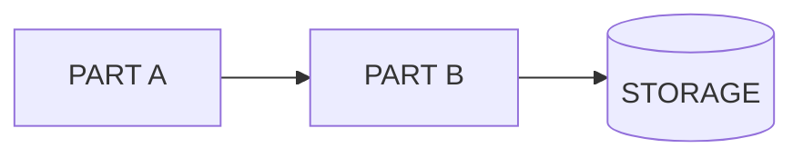

# Architecture Design

## What this file is for

It shows how the project is structured: its folders, the files that matter and what each one does, and the direction the structure is planned to take.

The main session reads it before planning a change, so that it knows where the change belongs and which files it touches, and does not build a second home for something that already has one.

## What goes in it, and what stays out

Goes in:

- The folder tree of the project's own code. Generated folders, such as build output and installed packages, are left out.
- The key files, grouped by folder, with one line on any file whose name does not say what it does
- Optionally, one overview diagram of the parts of the project and how they connect
- A link to the [Data Flow](DataFlow.md) page
- The planned direction, in its own section, marked as not built, with the numbers of the ADRs that decide it

Stays out:

- The rules the structure must follow. They are standing rules and belong in [Decisions and Consistency](Decisions_Consistency.md); this page cites them by ADR number.
- The path a request takes, hop by hop. That is in [Data Flow](DataFlow.md).
- Build, test and run commands. They belong in the agent guidance file or the README.
- What is being worked on now. That belongs with the [current-focus document](Current_Focus.md).

## Skeleton

Copy the page outline and replace the text in angle brackets. Repeat a `###` block for each folder that holds key files. The overview diagram is optional: delete its section if the project does not need one, or replace every word in capitals with the name of a part and add a node for each part.

Placeholders: `<date>`, `<project>`, `<folder>`, `<file>`, `<what it does>`, `<direction>`, `<ADR-NNN>`, `PART A`, `PART B`, `STORAGE`, and the text in angle brackets in the outline.

````markdown
# Architecture Design

Last updated: <date>

## Structure

```text
<project>/
├── <folder>/
│   └── <folder>/
└── <folder>/
```

## Key files

### <folder>/
- <file>: <what it does, when the name does not say it>

## Overview



How data moves through these parts: [Data Flow](<path>)

## Planned direction

Not built yet.

- <direction> (<ADR-NNN>)
````

## Examples

Excerpts from the architecture documents of BabyBuddyHelper and InvoiceMe arrive in `Examples/` with [#7](https://github.com/MatheusCastro99/AgenticDevelopmentWorkflow/issues/7).
