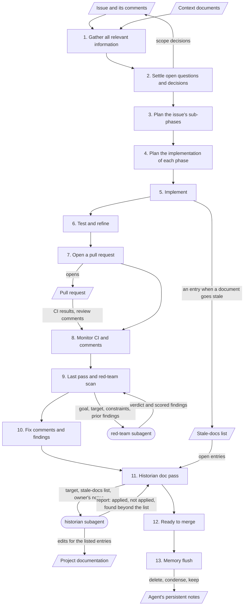
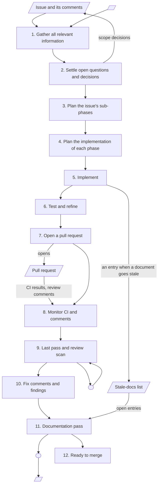

# Data Flow

## What this file is for

It draws the workflow as one diagram: the stages of an issue, the two subagents, and the documents that move between them. It shows what [Development Workflow](Development_Workflow.md) describes in words.

The agent reads it to see where a subagent runs and what to hand it. A reader new to the project sees the whole path of an issue at a glance.

## What goes in it, and what stays out

Goes in:

- The stages, in order
- Each subagent, at the stage where it runs, with what it receives and what it returns
- The documents a stage reads or writes: the issue, the context documents, the stale-docs list, the pull request, the project documentation

Stays out:

- What happens inside a stage. That is in [Development Workflow](Development_Workflow.md).
- The owner's approval at the end of each stage. It applies to every stage, so drawing it thirteen times would hide the rest.
- The project's own runtime data flow (requests, storage, screens). That belongs with the architecture document.

## The diagram

Boxes are stages, rounded shapes are subagents, and slanted shapes are documents. The owner approves the end of every stage; see [Working Agreements](Working_Agreements.md).



What each subagent receives and returns:

| Subagent | Runs at | Receives | Returns |
|---|---|---|---|
| red-team | Stage 9, on the finished change | The goal (the issue and its decided scope), the target (branch, commit range or pull request), the constraints (what is out of scope), and prior findings on a re-review | A verdict and scored findings, each with evidence. It edits nothing. |
| historian | Stage 11, once the change is final | The target, the stale-docs list, and the owner's notes on entries already rejected or changed | Edits for the listed entries, and a report: what it applied, what it did not apply and why, and what it found beyond the list. It edits nothing beyond the list and never commits. |

## Skeleton

Copy the block, replace every `<placeholder>`, and remove the stages or subagents your project does not use. Mermaid reads angle brackets as HTML, so a placeholder left in place renders as an empty label.

Placeholders: `<review subagent>`, `<documentation subagent>`, `<context documents>`, `<project documentation>`, `<what the review subagent receives>`, `<what it returns>`, `<what the documentation subagent receives>`, `<what it returns>`.

````markdown

````

## Examples

Diagrams from BabyBuddyHelper and InvoiceMe arrive in `Examples/` with [#7](https://github.com/MatheusCastro99/AgenticDevelopmentWorkflow/issues/7).
