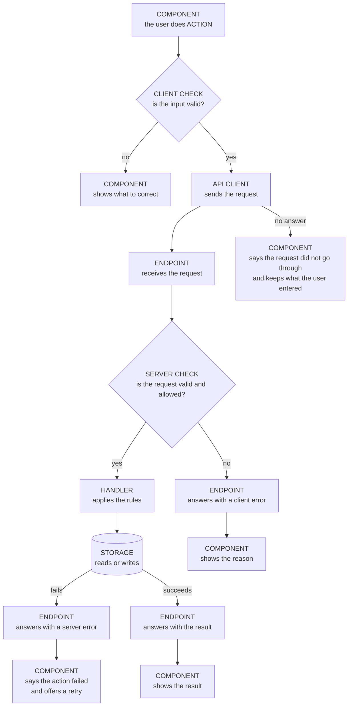

# Data Flow

## What this file is for

It shows how data moves through the project: from the component where the user acts, to the endpoint that handles the request, to storage, and back to what the user sees. It shows the error and failsafe routes as well as the successful one.

The agent reads it before changing anything on that path, so that it knows every hop a change touches and does not add a second route beside the one that exists.

## What goes in it, and what stays out

Goes in:

- One diagram for each user action that matters (saving a record, signing in, loading a list)
- Every hop on the path, named by the file or component that does the work
- Where the data is checked, and where it is stored
- The error routes: what happens when a check fails, when the server or storage fails, and when nothing answers
- What the user sees at the end of each route

Stays out:

- The folder structure and the list of key files. That belongs with the architecture document.
- The rules the path must follow, such as a single source of truth. They are standing rules and belong with the decisions document.
- How an issue is worked. That is in [Development Workflow](Development_Workflow.md).
- Paths that are planned and not built. Draw what the project does today.

## Skeleton

Copy the page outline and the diagram, give each diagram the name of its action, and replace every word in capitals. Add or remove hops until the diagram matches the path in the project: a project with no server has no endpoint, and its path runs from the component to a service to storage.

Placeholders: `DATE`, `ACTION`, `COMPONENT`, `CLIENT CHECK`, `API CLIENT`, `ENDPOINT`, `SERVER CHECK`, `HANDLER`, `STORAGE`, and the messages the user can end on.

The page outline:

```markdown
# Data Flow

Last updated: DATE

## ACTION

<the diagram for this action>

Notes:
- <Anything the diagram cannot show: a retry limit, a cache that is updated, a rule about ordering.>
```

The diagram for one action. It is drawn here; its source is the `mermaid` block at this place in the file.



## Examples

Data flow diagrams from BabyBuddyHelper and InvoiceMe arrive in `Examples/` with [#7](https://github.com/MatheusCastro99/AgenticDevelopmentWorkflow/issues/7).
