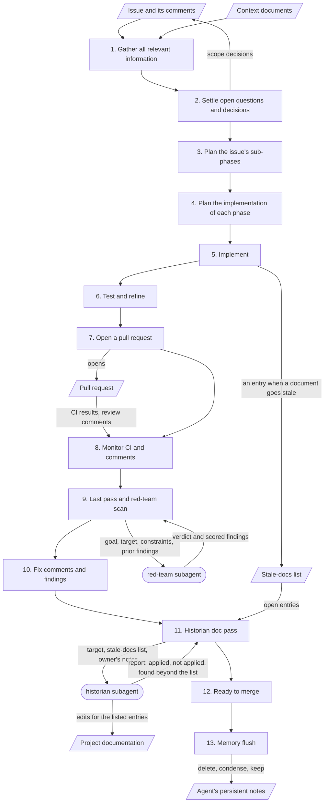

# Development Workflow

## What this file is for

It lists the stages every issue goes through, in order, from gathering information to the memory flush. For each stage it says what happens, who acts, what is produced, and what the owner approves before the next stage starts.

The agent reads it so that it never has to guess what comes next, and so that it stops where the owner expects it to stop.

## What goes in it, and what stays out

Goes in:

- The stages, in their fixed order
- For each stage: what happens, who acts, what is produced, what is approved
- The few rules that apply to every stage
- One diagram of the stages, the subagents and the documents that move between them

Stays out:

- Who decides and how findings are triaged. That is in [Working Agreements](Working_Agreements.md).
- How each subagent is configured and briefed. That is in `AI_Env/Agents/`.
- Build, test and run commands. They belong with the project's architecture document or its agent guidance file.
- The plan for any one issue. That lives in the issue.

## Rules for every stage

- Do not jump a stage. Every open decision is settled before the sub-phase plan, and that plan before the implementation plans.
- The agent says which stage the work is in whenever it reports.
- A stage ends with a report to the owner. The next one starts when the owner says so.
- A scope change at any stage goes into the issue before it goes into the work.
- One issue, one branch, one pull request. When planning spans several issues, the planning documents get their own small pull request, merged before the first issue starts.

## The stages

| # | Stage | Ends when the owner approves |
|---|---|---|
| 1 | Gather all relevant information | The summary of what was found |
| 2 | Settle open questions and decisions | Every open decision |
| 3 | Plan the issue's sub-phases | The phase list |
| 4 | Plan the implementation of each phase | Each phase's plan |
| 5 | Implement | Each phase, before its commit |
| 6 | Test and refine | The result of their own verification |
| 7 | Open a pull request | The push and the pull request |
| 8 | Monitor CI and comments | What to do with each comment |
| 9 | Last pass and red-team scan | What to do with each finding |
| 10 | Fix comments and findings | The fixes |
| 11 | Historian doc pass | The documentation diff |
| 12 | Ready to merge | The merge |
| 13 | Memory flush | The list of what to delete, condense and keep |

### 1. Gather all relevant information

- **What happens:** the agent reads the issue and its comments, the context documents, and the parts of the project the issue touches. It checks the facts the issue states against the project as it is today.
- **Who acts:** the agent.
- **Produces:** a summary of what was found, any fact in the issue that turned out wrong, and the list of open decisions.
- **Approved before the next stage:** the owner confirms the summary, or corrects it.

### 2. Settle open questions and decisions

- **What happens:** the agent presents each open decision as options with a recommendation, as described in [Working Agreements](Working_Agreements.md). The owner decides.
- **Who acts:** the agent recommends; the owner decides.
- **Produces:** the decided scope. Directional decisions are posted as a comment on the issue.
- **Approved before the next stage:** every open decision is settled, and the owner has approved the comment before it is posted.

### 3. Plan the issue's sub-phases

- **What happens:** the agent splits the issue into phases small enough to review one at a time, and gives their order and the reason for it.
- **Who acts:** the agent.
- **Produces:** the phase list, one commit per phase.
- **Approved before the next stage:** the owner approves the phase list, or reorders it.

### 4. Plan the implementation of each phase

- **What happens:** for each phase, the agent says which files change, how, and how the result will be verified.
- **Who acts:** the agent.
- **Produces:** an implementation plan per phase.
- **Approved before the next stage:** the owner approves the plan for a phase before that phase is implemented.

### 5. Implement

- **What happens:** the agent implements one phase and reports it: what changed, which files, how it was verified. When a change makes a document untrue, the agent adds an entry to the stale-docs list at that moment.
- **Who acts:** the agent.
- **Produces:** one commit per approved phase, and the running stale-docs list ([template](../../Templates/stale-docs.md)).
- **Approved before the next stage:** the owner approves each phase before the agent commits it and starts the next one.

### 6. Test and refine

- **What happens:** the agent runs the project's builds, tests and checks, and fixes what they show. The owner verifies the change their own way.
- **Who acts:** the agent and the owner.
- **Produces:** the verification results, and commits for anything refined.
- **Approved before the next stage:** the owner is satisfied the change works.

### 7. Open a pull request

- **What happens:** the agent pushes the branch and opens a pull request that links the issue.
- **Who acts:** the agent, after the owner confirms each action.
- **Produces:** the pull request.
- **Approved before the next stage:** the push and the pull request are each confirmed before they happen.

### 8. Monitor CI and comments

- **What happens:** the agent watches the CI runs and the review comments, including those from automated reviewers, and triages each comment as described in [Working Agreements](Working_Agreements.md).
- **Who acts:** the agent.
- **Produces:** the CI result, and for each comment a recommendation to fix or decline.
- **Approved before the next stage:** the owner decides what happens with each comment.

### 9. Last pass and red-team scan

- **What happens:** the agent reads the whole change once more against the issue and its acceptance criteria. It then briefs the red-team subagent with the goal, the target and the constraints. The red-team reviews the change with no knowledge of the session and returns scored findings. The agent triages them.
- **Who acts:** the agent and the red-team subagent.
- **Produces:** the red-team's findings, each with the agent's recommendation to fix or decline.
- **Approved before the next stage:** the owner decides what happens with each finding. If the agent proposes skipping the scan for a small mechanical change, the owner approves the skip.

### 10. Fix comments and findings

- **What happens:** the agent makes the fixes the owner approved in stages 8 and 9, and answers the review comments. A fix that changes much goes back to the red-team; the same change is reviewed at most twice.
- **Who acts:** the agent.
- **Produces:** the fix commits, and replies to the comments.
- **Approved before the next stage:** the owner approves the fixes before they are committed and pushed.

### 11. Historian doc pass

- **What happens:** once the change is final, the agent briefs the historian subagent with the stale-docs list. The historian checks each entry against the repository, applies the listed entries, and reports anything else it finds without editing it. The owner reviews its diff against the list and the change.
- **Who acts:** the agent, the historian subagent and the owner.
- **Produces:** the historian's report, and one documentation commit made by the agent after the review.
- **Approved before the next stage:** the owner approves the documentation diff and decides on each finding beyond the list.

### 12. Ready to merge

- **What happens:** the agent confirms that CI passes, every comment and finding is closed, and every acceptance criterion is met, and says so.
- **Who acts:** the agent reports; the owner merges.
- **Produces:** the merged pull request and the closed issue.
- **Approved before the next stage:** the merge itself is the owner's approval.

### 13. Memory flush

- **What happens:** the agent goes through its persistent notes and the session's scratch files, and lists each as delete, condense or keep. Notes on finished work are condensed to the outcome, the deferred follow-ups and the lasting lessons.
- **Who acts:** the agent.
- **Produces:** a shorter set of notes for the next session to start from.
- **Approved before the next stage:** the owner approves the list before anything is deleted or changed.

This stage runs only when an epic is closed out, or after an issue that has no parent and no sibling issues. A sub-issue of an open epic gets no flush; its notes wait for the close-out.

## The workflow as a diagram

Boxes are stages, rounded shapes are subagents, and slanted shapes are documents. The owner's approval at the end of every stage is not drawn; it applies to all thirteen.



What each subagent receives and returns:

| Subagent | Runs at | Receives | Returns |
|---|---|---|---|
| red-team | Stage 9, on the finished change | The goal (the issue and its decided scope), the target (branch, commit range or pull request), the constraints (what is out of scope), and prior findings on a re-review | A verdict and scored findings, each with evidence. It edits nothing. |
| historian | Stage 11, once the change is final | The target, the stale-docs list, and the owner's notes on entries already rejected or changed | Edits for the listed entries, and a report: what it applied, what it did not apply and why, and what it found beyond the list. It edits nothing beyond the list and never commits. |

## Skeleton

```markdown
# Development Workflow

Every issue goes through these stages, in order.

## Rules for every stage
- <Do not jump a stage.>
- <Say which stage the work is in when reporting.>
- <Branch and pull request rule: one issue, one branch, one pull request>

## The stages

### <n>. <Stage name>
- **What happens:** <…>
- **Who acts:** <agent | owner | subagent name>
- **Produces:** <…>
- **Approved before the next stage:** <…>

<!-- Repeat for each stage. Starting list:
1. Gather all relevant information
2. Settle open questions and decisions
3. Plan the issue's sub-phases
4. Plan the implementation of each phase
5. Implement
6. Test and refine
7. Open a pull request
8. Monitor CI and comments      reviewers: <CI checks, review bots>
9. Last pass and red-team scan
10. Fix comments and findings
11. Historian doc pass          documents in scope: <paths>
12. Ready to merge
13. Memory flush                runs when: <epic close-out | isolated issue>
-->
```

## Examples

Excerpts showing how BabyBuddyHelper and InvoiceMe apply these stages arrive in `Examples/` with [#7](https://github.com/MatheusCastro99/AgenticDevelopmentWorkflow/issues/7).
